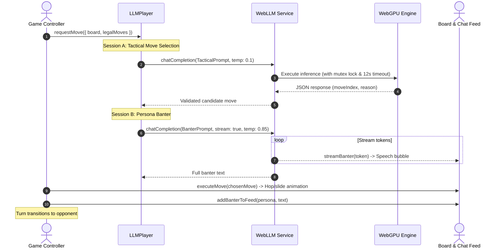

# ♟️ Checkers (English Draughts) with In-Browser LLM AI & Spectator Arena

[](https://github.com/jpeckenpaugh/chk-livive-net)
[](https://chk.livive.net/)
[](LICENSE)

A modern, zero-dependency, client-side implementation of **English Draughts (Checkers)** featuring on-device **WebLLM AI** (Llama 3.2, SmolLM2), persona banter streaming, an AI vs. AI Spectator Arena, offline Minimax AI, and a full rules engine with 100% test coverage.

🌐 **Live Demo:** [chk.livive.net](https://chk.livive.net/)

---

## 🌟 Key Features

- **🧠 On-Device Local LLM Opponents**: Powered by [WebLLM](https://github.com/mlc-ai/web-llm) running directly in the browser via **WebGPU**. Model weights are downloaded once and cached permanently across sessions in the browser's IndexedDB / Cache API.
- **💬 Dual-Session AI Architecture**:
  - **Session A (Tactical Engine)**: Receives board state and strictly enumerated legal moves; outputs structured move selection with JSON parsing, corrective retries, and heuristic fallbacks.
  - **Session B (Personality Banter)**: Generates real-time streaming commentary, witty insults, and reactions in character before executing the move.
- **🎭 Diverse Persona Profiles**: Play against 8 unique AI personas, including *Lord Worthington* (Victorian snob), *Captain Blackbeard* (pirate rogue), *UNIT-734* (calculating robot), *Grandmaster Boris* (Russian chess master), and more.
- **⚔️ AI vs. AI Spectator Arena**: Watch model vs. model, persona vs. persona, or LLM vs. Minimax face-offs with interactive spectator controls (Play, Pause, Step Move, Speed slider) and a side-by-side Live Banter Feed.
- **👤 Classic Minimax AI**: Alpha-Beta pruning minimax engine with piece-square tables, king prioritization, center control, and three difficulty presets (Easy, Medium, Hard) that runs 100% offline without WebGPU.
- **👥 Local Pass-and-Play**: Two-player pass-and-play mode on a shared screen.
- **🔍 Built-In Prompt & Engine Debugger**: Inspect turn-by-turn raw system/user prompts, raw completions, latency metrics, tokens/second, and fallback histories.
- **🚀 Preload Hardware Staging Screen**: Explicit pre-match staging screen that tests WebGPU capabilities, tracks weight download progress, compiles shaders, and performs sanity warm-ups before Turn 1 begins.
- **🎨 Polished UX**: Hop/slide animations, capture dissipation effects, king crowning fanfare, audio effects via Web Audio API, dark square coordinate numbering toggle, and board rotation.
- **📜 Strict English Draughts Rules**: Full compliance with official rules: mandatory captures, multi-jump lock enforcement, immediate crowning turn termination, and the 40-move draw rule (80 half-moves without capture or advance).
- **⚡ Zero External Build Dependencies**: Written in pure vanilla ES Modules, HTML5, and CSS Grid. Runs statically on any web server or GitHub Pages without Webpack, Vite, or Node build steps.

---

## 🎮 Game Modes

| Mode | Description | Requirements |
| :--- | :--- | :--- |
| **👤 Player vs Minimax AI** | Classic offline draughts against a fast alpha-beta minimax engine. | None (runs on any browser) |
| **🤖 Player vs LLM AI** | Match against a local neural model with real-time speech bubbles and persona taunts. | WebGPU-enabled browser (Chrome, Edge, Safari 18+) |
| **⚔️ AI vs AI Arena** | Spectator arena pitting LLM personas or Minimax against each other. | WebGPU (if using LLM participants) |
| **👥 Pass & Play** | Local two-player game on the same device. | None |

---

## 🧠 Supported On-Device Models

Models are selectable from the Title Screen, Arena Modal, and LLM Dashboard:

| Model ID | Parameters | Quantization | Est. VRAM / Download | Recommended Hardware |
| :--- | :--- | :--- | :--- | :--- |
| `Llama-3.2-1B-Instruct-q4f16_1-MLC` *(Default)* | 1.2 Billion | 4-bit / f16 | ~850 MB | Modern Laptops, Apple Silicon M1+, Desktop GPUs |
| `SmolLM2-1.7B-Instruct-q4f16_1-MLC` | 1.7 Billion | 4-bit / f16 | ~1.1 GB | Dedicated GPUs, Apple Silicon M1+ |
| `SmolLM2-360M-Instruct-q4f16_1-MLC` | 360 Million | 4-bit / f16 | ~380 MB | Lightweight devices, Integrated Intel/AMD GPUs |
| `Llama-3.2-3B-Instruct-q4f16_1-MLC` | 3.2 Billion | 4-bit / f16 | ~2.2 GB | High-tier GPUs (6GB+ VRAM, M-series Pro/Max) |

---

## 🏗️ Technical Architecture

### 1. Board Representation & Coordinate Scheme
The board uses the standard **32-dark-square indexing** scheme (0 to 31) standard in English Draughts:
- **Red (1)** starts on squares `20` through `31` (bottom rows 5, 6, 7) and moves upward (`row - 1`).
- **Black (-1)** starts on squares `0` through `11` (top rows 0, 1, 2) and moves downward (`row + 1`).
- Squares `12` through `19` form the neutral middle ranks.
- Pieces are represented by 8-bit integers: `1` (Red Man), `2` (Red King), `-1` (Black Man), `-2` (Black King), `0` (Empty).
- In-place mutation helpers (`applyMoveInPlace` and `undoMoveInPlace`) ensure high-depth Minimax search runs without garbage collection overhead.

### 2. Dual-Session LLM Pipeline


### 3. Concurrency Safety & Mutex Protection
WebLLM runs on a single WebGPU command queue. To prevent pipeline deadlocks or browser freezes:
- **Sequential Mutex (`_inferenceLock`)**: All model requests are queued in a deterministic promise chain so that Session A, Session B, and spectator turns never issue concurrent GPU dispatches.
- **Hard Inference Timeouts**: Tactical move generations time out after 12 seconds; banter times out after 7 seconds.
- **Engine-Level Interrupts**: When a timeout or user abort occurs, `engine.interruptGenerate()` is immediately invoked to release WebGPU execution buffers.
- **Multi-Jump Optimization**: During capture chains (`mustContinueJumpFrom`), banter is bypassed so chained captures happen at instant 250ms cadence.
- **Automatic Fallback Persistence**: If a browser environment restricts Web Worker module imports, the bridge automatically routes execution in-process (the architecture proven in `rag-poc`) and persists `chk_prefer_in_process: true` in `localStorage`.

---

## 📁 Project Structure

```text
.
├── CNAME                         # Custom domain for GitHub Pages (chk.livive.net)
├── favicon.ico                   # Game favicon (ICO)
├── favicon.svg                   # Game favicon (SVG)
├── index.html                    # Single-page application markup & modal screens
├── styles.css                    # CSS Grid layout, animations, theme variables
├── package.json                  # Node test scripts and metadata
├── README.md                     # Documentation
│
├── src/
│   ├── main.js                   # Application bootstrap & initialization
│   ├── state.js                  # State model, 32-square board topology, coordinate transforms
│   ├── rules.js                  # Pure rules engine, mandatory capture logic, crowning, 40-move draw
│   ├── ai.js                     # Minimax AI with Alpha-Beta pruning and heuristic evaluation
│   ├── renderer.js               # DOM board rendering, move animations, audio, spectator feeds
│   ├── controller.js             # Game lifecycle state machine, event routing, turn scheduler
│   │
│   ├── llm/                      # WebLLM & Neural Engine Subsystem
│   │   ├── model_registry.js     # Supported models, metadata, and localStorage preferences
│   │   ├── gpu_check.js          # WebGPU adapter query and hardware feature inspection
│   │   ├── personas.js           # 8 AI personality profiles and system banter prompts
│   │   ├── prompts.js            # Board serialization, tactical prompts, and retry prompts
│   │   ├── parser.js             # Robust JSON/regex move parser with corrective retry loop
│   │   ├── web_llm_service.js    # WebLLM multi-CDN loader, mutex queue, timeouts, test bench
│   │   ├── dashboard.js          # Modal UI for GPU inspection, cache management, test bench
│   │   └── debug_inspector.js    # Slide-out drawer displaying turn-by-turn prompt telemetry
│   │
│   ├── players/                  # Pluggable Player Abstraction
│   │   ├── base_player.js        # Base interface for turn execution
│   │   ├── human_player.js       # Human interaction adapter
│   │   ├── minimax_player.js     # Alpha-Beta minimax adapter
│   │   └── llm_player.js         # WebLLM player coordinating Session A & Session B
│   │
│   └── workers/                  # Worker Scaffolding & Fallback Bridge
│       ├── llm_bridge.js         # Singleton bridge managing worker/in-process execution & telemetry
│       └── llm_worker.js         # Dedicated Web Worker script with polyfills and error handlers
│
└── test/                         # Native Node Test Suite (Zero External Dependencies)
    ├── test_rules.js             # Board geometry, direction constraints, mandatory jumps, draws
    ├── test_ai.js                # Minimax heuristics, capture ordering, difficulty depth
    ├── test_controller.js        # Pass-and-play selection, multi-jump lock, restart mechanics
    ├── test_players.js           # Player class contracts and lifecycle transitions
    ├── test_llm_parser.js        # JSON extraction, markdown fences, regex fallback, retries
    ├── test_spectator.js         # Spectator pause, play, step controls, and arena auto-play
    ├── test_dashboard.js         # GPU detection, CDN fallbacks, telemetry logging, error recovery
    ├── test_polish.js            # 40-move rule, draw reasons, match stats, keyboard shortcuts
    ├── test_worker_bridge.js     # Bridge messaging, mock engine simulation, forced move bypass
    └── test_lifecycle.js         # Title screen, Preload staging gate, match launch pipeline
```

---

## 🧪 Testing

The codebase includes **10 comprehensive test suites** containing **100 tests** executed with Node.js's built-in test runner (`node --test`), requiring zero third-party testing dependencies:

```bash
npm test
```

### Test Coverage Highlights
- **Rules Engine (`test_rules.js`)**: Dark square coordinate round-tripping, directional constraints for men vs kings, mandatory capture enforcement, multi-jump sequences, crowning halts jump sequences immediately.
- **AI Engine (`test_ai.js`)**: Material balance, king promotion incentives, back-rank defensive heuristics, alpha-beta pruning cutoff verification.
- **LLM Parser (`test_llm_parser.js`)**: Markdown-wrapped JSON blocks, malformed text recovery, regex index extraction, out-of-bounds recovery, and fallback heuristic engagement.
- **Concurrency & Lifecycle (`test_worker_bridge.js`, `test_lifecycle.js`)**: State transitions (`TITLE` ➔ `PRELOAD` ➔ `PLAYING` ➔ `GAMEOVER`), mock model pipeline verification, forced-move optimization bypass, telemetry recording.

---

## 💻 Local Development

Run the game locally using any static web server:

```bash
# Using Python 3:
python3 -m http.server 8000

# Using Node / npx:
npx serve .

# Or open index.html directly in a modern WebGPU-compatible browser:
open index.html
```

Visit `http://localhost:8000` in your browser.

> [!TIP]
> For WebLLM AI functionality, ensure you are using a browser with WebGPU enabled (Google Chrome 113+, Microsoft Edge 113+, or Safari 18+). Minimax and Pass-and-Play work on all modern browsers without WebGPU.

---

## ⌨️ Keyboard Shortcuts

| Key | Action |
| :---: | :--- |
| `Esc` | Deselect current piece |
| `R` | Restart game |
| `F` | Flip / rotate board 180° |
| `N` | Toggle dark square numbers (1–32) |
| `M` | Toggle sound mute |

---

## 📜 License

MIT License. See [LICENSE](LICENSE) for details.
